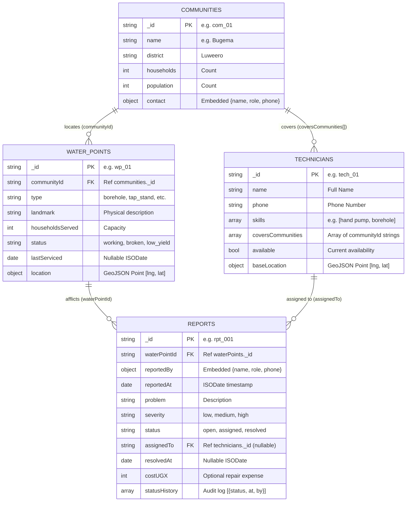

# Community Water Point Tracker
## A NoSQL Database Design for Rural Water Infrastructure Maintenance
### Bugema University — School of Science and Technology

**Course:** MongoDB Database Design  
**Student:** Moses Tandu Zachariah Hissen  
**Registration Number:** 24/BCC/BU/R/0016  
**Location:** Kalagala Sub-county, Luweero District, Uganda  
**Date:** October 2026  

---

## 1. Problem and Problem Statement

### 1.1 Context
In the peri-urban and rural communities surrounding Bugema University in Kalagala Sub-county, Luweero District (specifically Bugema, Kalagala, Ziroobwe, Bamunanika, and Wobulenzi), communal water points—including deep boreholes, protected natural springs, shallow wells, and public tap stands—constitute the primary source of clean domestic water for thousands of households.

### 1.2 Problem Statement
The communities around Bugema University lack a single, shared system of record linking water points, breakdown reports, and qualified repair technicians. Consequently:
- **Informal Breakdown Reporting:** Faults are reported verbally through local market vendors or informal channels, leading to lost, duplicate, or undocumented reports.
- **Ad-Hoc Technician Allocation:** Sub-county dispatchers do not possess an up-to-date registry of available technicians, their specific competencies (e.g., hand pump vs. piped water mechanics), or geographic coverage areas.
- **Unmeasured Downtime:** Response times (Mean Time to Assign and Mean Time to Resolve) are never recorded, resulting in water points remaining broken for months without administrative visibility.
- **Lost Historical Maintenance Records:** Without chronological tracking, recurring mechanical failures cannot be distinguished from routine wear and tear, and preventative maintenance is neglected.

### 1.3 Scope and Limitations
This project addresses the **information and coordination** causes of extended water outages by engineering a unified NoSQL database in MongoDB. It establishes an auditable system of record for rapid fault reporting, skill-matched technician dispatching, and lifecycle repair tracking. This project does not claim to manufacture physical replacement parts or perform civil engineering repairs.

---

## 2. How MongoDB Solves It

MongoDB was chosen over traditional Relational Database Management Systems (RDBMS) due to the dynamic, polymorphic, and geospatial characteristics of communal water management:

1. **Flexible Document Model for Heterogeneous Hardware:**  
   Different water point categories require different operational attributes. A municipal tap stand possesses a `managedBy` committee field, while a deep borehole records pump cylinder depth. In a rigid relational schema, this demands numerous nullable columns or complex multi-table joins. MongoDB's BSON document model allows polymorphic documents within a single `waterPoints` collection without schema bloat.

2. **Embedded Sub-documents for Localized Contact Data:**  
   Community local council chairpersons and citizen reporters are modeled as embedded sub-documents (`contact: { name, role, phone }`). This guarantees atomic reads in a single disk lookup without requiring relational foreign key joins.

3. **Multikey Array Indexing for Skills and Geographic Coverage:**  
   Technicians service multiple communities and possess varied skillsets (e.g., `["hand pump", "borehole"]`). MongoDB natively indexes array elements (multikey indexing), enabling queries like `{ coversCommunities: "com_02", available: true }` to execute in sub-millisecond time.

4. **Native GeoJSON and 2dsphere Spatial Queries:**  
   MongoDB provides first-class support for Earth-spherical geometry. By storing coordinates in GeoJSON format (`{ type: "Point", coordinates: [lng, lat] }`), dispatchers can calculate the exact Euclidean and spherical distance from a broken well to the nearest available technician using the `$near` and `$geoNear` operators.

5. **Multi-Document ACID Transactions:**  
   When a repair is finalized, two distinct collections must be updated simultaneously: `reports` (marked resolved with cost) and `waterPoints` (status reverted to "working"). MongoDB's multi-document transactions ensure ACID atomicity across collections.

---

## 3. Entities

The system models four core real-world domain entities:



### Statutory Compliance Note (Uganda Data Protection and Privacy Act, 2019)
All personal names, telephone numbers, and specific figures utilized in this academic project are **fictional seed values**. In any future production deployment, citizen and technician contact information must comply with the **Uganda Data Protection and Privacy Act (2019)**:
- Explicit consent must be recorded before storing personal phone numbers.
- Role-based access control (RBAC) must prevent unauthorized extraction of technician registries.
- Personal data retention must strictly align with maintenance auditing requirements.

---

## 4. Collections and Sample Documents

The database `waterTracker` comprises exactly four collections containing **21 seed documents** (5 communities, 6 waterPoints, 5 technicians, 5 reports). String identifiers (`com_01`, `wp_01`, `tech_01`, `rpt_001`) are used for explicit, human-readable referential integrity.

### 4.1 `communities` Collection (5 Documents)
*Represents administrative settlements in Luweero District.*

```json
{
  "_id": "com_01",
  "name": "Bugema",
  "district": "Luweero",
  "households": 320,
  "population": 1800,
  "contact": {
    "name": "Esther Nakato",
    "role": "Local Council Chairperson",
    "phone": "0700 000 101"
  },
  "universityLink": "Student volunteers visit monthly"
}
```

### 4.2 `waterPoints` Collection (6 Documents)
*Represents physical clean water extraction assets.*

```json
{
  "_id": "wp_02",
  "communityId": "com_02",
  "type": "borehole",
  "landmark": "Behind Kalagala Central Market",
  "installedYear": 2012,
  "householdsServed": 200,
  "status": "broken",
  "lastServiced": { "$date": "2025-11-02T00:00:00Z" },
  "location": {
    "type": "Point",
    "coordinates": [32.6120, 0.6110]
  }
}
```

### 4.3 `technicians` Collection (5 Documents)
*Represents certified local artisans and hand pump mechanics.*

```json
{
  "_id": "tech_01",
  "name": "Ibrahim Kalule",
  "phone": "0770 000 201",
  "skills": ["hand pump", "borehole"],
  "coversCommunities": ["com_01", "com_02"],
  "available": true,
  "baseLocation": {
    "type": "Point",
    "coordinates": [32.6130, 0.6120]
  }
}
```

### 4.4 `reports` Collection (5 Documents)
*Represents citizen breakdown complaints and repair lifecycles.*

```json
{
  "_id": "rpt_001",
  "waterPointId": "wp_02",
  "reportedBy": {
    "name": "Peter Ssemwogerere",
    "phone": "0700 000 102"
  },
  "reportedAt": { "$date": "2026-10-09T07:15:00Z" },
  "problem": "Pump handle snapped",
  "severity": "high",
  "status": "assigned",
  "assignedTo": "tech_01",
  "resolvedAt": null,
  "statusHistory": [
    {
      "status": "open",
      "at": { "$date": "2026-10-09T07:15:00Z" },
      "by": "Peter Ssemwogerere (Community Reporter)"
    },
    {
      "status": "assigned",
      "at": { "$date": "2026-10-09T08:30:00Z" },
      "by": "Kalagala Water Desk Dispatcher"
    }
  ]
}
```

---

## 5. Useful Queries and Analytical Pipelines

### 5.1 Query 1: Filter Broken Water Points
- **Objective:** Identify all malfunctioning water points requiring attention.
- **Command:**
  ```javascript
  db.waterPoints.find({ status: "broken" });
  ```
- **Verified Output:** Returns `wp_02` (Kalagala borehole) and `wp_05` (Ziroobwe tap stand).
- **Viva Note:** Utilizes the `{ status: 1 }` index for direct B-Tree lookup.

### 5.2 Query 2: Find Available Technicians for Kalagala
- **Objective:** Find active mechanics authorized to work in `com_02`.
- **Command:**
  ```javascript
  db.technicians.find({ coversCommunities: "com_02", available: true });
  ```
- **Verified Output:** Returns `tech_01` (Ibrahim Kalule) and `tech_04` (Mariam Nabirye).
- **Viva Note:** `coversCommunities` is a multikey array; MongoDB automatically checks if `"com_02"` is an element within the array.

### 5.3 Query 3: Open Breakdown Reports (FIFO Dispatch Queue)
- **Objective:** Enforce a First-In, First-Out service standard by reviewing unassigned complaints ordered by wait time.
- **Command:**
  ```javascript
  db.reports.find({ status: "open" }).sort({ reportedAt: 1 });
  ```
- **Verified Output:** Returns `rpt_002` (Oct 5) followed by `rpt_003` (Oct 11).
- **Viva Note:** Uses compound index `{ status: 1, reportedAt: 1 }` to eliminate in-memory sorting.

### 5.4 Query 4: Multi-Document ACID Transaction (Record Finished Repair)
- **Objective:** Simultaneously mark report `rpt_001` resolved and water point `wp_02` working.
- **Command:**
  ```javascript
  const session = db.getMongo().startSession();
  try {
    session.startTransaction({
      readConcern: { level: "snapshot" },
      writeConcern: { w: "majority" }
    });

    const reportsColl = session.getDatabase("waterTracker").reports;
    const wpColl = session.getDatabase("waterTracker").waterPoints;

    reportsColl.updateOne(
      { _id: "rpt_001" },
      { $set: { status: "resolved", resolvedAt: new Date(), costUGX: 60000 } }
    );

    wpColl.updateOne(
      { _id: "wp_02" },
      { $set: { status: "working" } }
    );

    session.commitTransaction();
  } catch (err) {
    session.abortTransaction();
  } finally {
    session.endSession();
  }
  ```
- **Viva Note:** MongoDB transactions require a replica set (`rs0`) because write-ahead coordination relies on the replica set **oplog**. Our rollback proof test (`scripts/transaction_rollback_test.js`) verifies that if a crash occurs mid-execution, partial changes are completely discarded.

### 5.5 Query 5: Count Broken Water Points Per Community
- **Objective:** Summarize hardware outages per administrative unit.
- **Command:**
  ```javascript
  db.waterPoints.aggregate([
    { $match: { status: "broken" } },
    { $group: { _id: "$communityId", brokenCount: { $sum: 1 } } },
    { $sort: { _id: 1 } }
  ]);
  ```
- **Verified Output:** `com_02: 1` (Kalagala), `com_03: 1` (Ziroobwe).

### 5.6 Strategic Analytical Pipelines
In addition to basic queries, the system implements 7 strategic analytical pipelines:
1. **Broken Points Joined to Community Names & Households:** Computes that Kalagala has **48.8%** of households affected, whereas Ziroobwe has **34.6%** affected.
2. **Mean Time to Assign & Resolve:** Evaluates an MTA of **1.69 hours** and an MTTR of **52.17 hours** (2.17 days).
3. **Repair Cost Breakdown:** Reveals protected spring repairs averaged 85,000 UGX vs borehole repairs at 40,000 UGX.
4. **Chronic Breakdown Recurrence:** Flags repeat hardware failures using `$push` arrays and count thresholds.
5. **Preventative Maintenance Backlog:** Discovers shallow well `wp_04` has `lastServiced: null` (flagged as `NEVER_SERVICED`).
6. **Technician Workload Capacity:** Identifies busy vs available mechanics.
7. **Impact-Weighted Dispatch Queue:** Prioritizes emergencies using $\text{Score} = \text{Severity Weight} \times \text{Households Served}$, ranking `rpt_001` (Score 600) ahead of `rpt_003` (Score 540) and `rpt_002` (Score 120).

---

## 6. Loading Data in MongoDB Compass

The database was populated through MongoDB Compass:

1. **Connection:** Connected to local instance at `mongodb://localhost:27017`.
2. **Database Initialization:** Created database `waterTracker` and initial collection `communities`.
3. **Collection Provisioning:** Added the three remaining collections: `waterPoints`, `technicians`, `reports`.
4. **Data Importation:**
   - Navigated to each collection &rarr; Clicked **Add Data** &rarr; **Import JSON or CSV file**.
   - Selected the corresponding Extended JSON file from the `/data` folder (`communities.json`, `waterPoints.json`, `technicians.json`, `reports.json`).
   - Verified the green confirmation toast: **"Import completed"**.
5. **BSON Type Validation:** Extended JSON syntax (`{"$date": "..."}`) was automatically converted into native BSON `ISODate` objects, and `null` was correctly imported without type coercion.

---

## 7. Evidence from MongoDB Compass

*(Place your captured screenshots from the [`screenshots/`](file:///c:/Users/Moses.DESKTOP-T41CS8K/Desktop/NOSQL%20PROJECT/screenshots) folder here before submitting or printing to PDF).*

### 7.1 Database Overview & Document Counts (5 / 6 / 5 / 5)
*Screenshot showing `waterTracker` database overview with the 4 collections totaling 21 documents.*  
`[Insert Screenshot: screenshots/01_database_overview.png]`

### 7.2 Collection Import Confirmations ("Import completed")
*Screenshots showing the green success toast upon importing each collection's JSON file.*  
`[Insert Screenshot: screenshots/02_import_communities.png]`  
`[Insert Screenshot: screenshots/03_import_waterPoints.png]`  
`[Insert Screenshot: screenshots/04_import_technicians.png]`  
`[Insert Screenshot: screenshots/05_import_reports.png]`  

### 7.3 Query 1: Filter Broken Water Points
*Filter bar `{ status: "broken" }` displaying `wp_02` and `wp_05`.*  
`[Insert Screenshot: screenshots/06_query1_broken_waterpoints.png]`

### 7.4 Query 2: Available Technicians in Kalagala
*Filter bar `{ coversCommunities: "com_02", available: true }` displaying `tech_01` and `tech_04`.*  
`[Insert Screenshot: screenshots/07_query2_available_technicians.png]`

### 7.5 Query 3: Open Reports (FIFO Queue)
*Filter `{ status: "open" }` with sort `{ reportedAt: 1 }` showing `rpt_002` then `rpt_003`.*  
`[Insert Screenshot: screenshots/08_query3_open_reports_fifo.png]`

### 7.6 Query 5: Aggregation Pipeline Builder
*Compass Aggregations tab showing `$match`, `$group`, and `$sort` stages with output preview.*  
`[Insert Screenshot: screenshots/09_query5_aggregation_pipeline.png]`

### 7.7 Schema Tab Analysis
*Compass Schema tab showing visual data type distributions and embedded document structures.*  
`[Insert Screenshot: screenshots/10_compass_schema_tab.png]`

---

## 8. Closing Note and System Limitations

### 8.1 Summary of Value Delivered
The **Community Water Point Tracker** database successfully models the socio-technical ecosystem of communal water supply in Kalagala Sub-county. By replacing fragmented paper logs with a unified MongoDB database:
- Citizen breakdown reports are instantaneously linked to physical water points.
- Local council dispatchers can identify skill-qualified, geographically proximate technicians in seconds.
- Mean response times and repair expenditures are systematically audited.
- Preventative maintenance schedules can be automated to protect community assets before catastrophic failure occurs.

### 8.2 Real-World Limitations
1. **Network Connectivity in Rural Areas:** In parts of Luweero District, cellular internet connectivity can be intermittent. A production mobile front-end would require an offline-first caching mechanism (e.g. Realm / MongoDB Atlas Device Sync) to buffer local reports until connectivity is restored.
2. **Physical Infrastructure and Spare Part Availability:** While the database solves information coordination and response visibility, actual repair completion remains constrained by local supply chain logistics and municipal spare part funding.
3. **Data Governance:** In compliance with Ugandan law, full-scale production implementation requires administrative user authorization, data privacy audits, and consent management for citizen phone numbers.

---

## 9. References

1. **MongoDB Manual (v8.0+):**
   - *Data Modeling Concepts:* https://www.mongodb.com/docs/manual/core/data-modeling-introduction/
   - *Multi-Document Transactions:* https://www.mongodb.com/docs/manual/core/transactions/
   - *Aggregation Pipeline Framework:* https://www.mongodb.com/docs/manual/core/aggregation-pipeline/
   - *Geospatial Queries & 2dsphere Indexes:* https://www.mongodb.com/docs/manual/geospatial-queries/
   - *JSON Schema Validation:* https://www.mongodb.com/docs/manual/core/schema-validation/
2. **MongoDB Compass Documentation:**
   - *Importing JSON and CSV Data:* https://www.mongodb.com/docs/compass/current/import-export/
   - *Aggregation Pipeline Builder:* https://www.mongodb.com/docs/compass/current/aggregations/
   - *Schema Analysis Tool:* https://www.mongodb.com/docs/compass/current/schema/
3. **Government of Uganda Legislation:**
   - *The Data Protection and Privacy Act, 2019:* Acts Supplement No. 1, Uganda Gazette No. 9, Vol. CXII, dated 28th February 2019.
